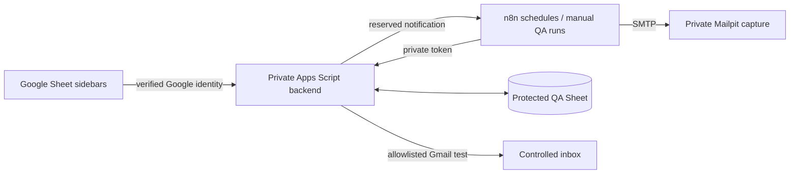

# Recurring Operations Automation

Google Sheets is the employee and manager operating interface. Employees use
**Ops Tasks → My tasks** to enter a ticket or daily report once. The state engine
records completion and history, prepares recurring work, evaluates SLA and
tracks manager acknowledgement independently of employee resolution.

## Current demonstration status

A separate private QA Sheet and owner-only Apps Script backend are deployed.
Live employee completion, daily reports, recurrence, Mailpit manager/leadership
notifications, calendar rules and retry prevention have genuine evidence.
**All eight assignment cases passed against the integrated QA system.** The
separate manager acknowledged Employee C, which remained Pending until its
later, explicitly simulated completion. Both limited Gmail test messages were
independently observed in the receiving account's Inbox. The original dummy
prototype and its active dry-run schedules remain separate.

Start with the [actual acceptance report](tests/test-results.md),
[genuine screenshots and record evidence](docs/evidence.md), and
[5–10 minute presenter walkthrough](tests/demo-script.md).
[Watch the genuine 5:10 screen review](docs/demo/qa-screen-review.mp4).
Private resource links and controlled Google account addresses are provided separately.

## QA employee and manager roles

| ID | Assignment | Demonstration identity |
| --- | --- | --- |
| EMP-A | Daily Operations Update | Project owner's main Google account; authenticated employee sidebar |
| EMP-B | Portal Task A, every 7 days | Distinct dummy employee; administrator-only QA simulation |
| EMP-C | Portal Task B, every 15 days | Distinct dummy employee; administrator-only QA simulation |
| EMP-D | Portal Task C, every 30 days | Distinct dummy employee; administrator-only QA simulation |

The **main Gmail account is the automation sender**, project owner and authenticated
Employee A. The **separate testing Gmail account is the authenticated test manager
and the recipient of the limited real Gmail delivery test**. Actual addresses stay
in private configuration; public setup uses `QA_ADMIN_EMAIL` and `QA_MANAGER_EMAIL`.
Manager authentication is independent of Mailpit's logical notification recipients.
Repeated manager and leadership tests use Mailpit, not the Gmail inbox.

The private administrator panel's **Simulate dummy completion** control validates
the Ticket ID and invokes the existing completion/recurrence engine. Records say
`SIMULATED:EMP-B`, `SIMULATED:EMP-C` or `SIMULATED:EMP-D`, with a `SIMULATED`
action mode, the authenticated administrator who initiated it, business time and
actual execution time. These are not authenticated logins by dummy employees.
Employee A and the manager cannot be simulated through this control. The normal
employee workflow still checks a Google-signed identity against task ownership.
The manager dashboard includes all employees and their completed, pending and
overdue cycles, proofs, acknowledgement, completion source, next cycles and history.

Earlier evidence temporarily mapped portal tasks to the owner's account to verify
authenticated ticket submission. That evidence is retained as an earlier test run;
the final role scenario uses the four distinct assignments above.

| Deliverable | Review material |
| --- | --- |
| Working Google Sheet prototype | Private QA Sheet: four dummy tasks, protected queue/history/dashboard/log/configuration, Sheet sidebars |
| Apps Script / automation | [Engine](apps-script/TaskManager.gs), [QA backend](apps-script/QA.gs), [Sheet client](apps-script/QASheetClient.gs), [sanitized QA n8n workflows](n8n-workflows/qa/) |
| Daily Task Completion Tracking | [Method and genuine live result](docs/daily-completion.md) |
| Manager Alerts & Leadership Escalation | [Timing](docs/sla-logic.md), three transports, [actual captures](docs/evidence/qa/mailpit-captures.json) |
| Working Demonstration / Test Cases | [Eight-case results](tests/test-results.md), [walkthrough and reset](tests/demo-script.md), [requirement audit](docs/requirements-checklist.md) |



Daily work is generated independently each working day. Periodic next due dates
are completion date + 7 / 15 / 30 calendar days, rolled forward over weekends
and configured holidays. QA visibly uses simulated business time; execution
and mail timestamps remain real. See [architecture](docs/architecture.md).

## Setup and review

Follow [QA installation](docs/qa-setup.md), [deployment record](docs/deployment-record.md)
and [verified limits](docs/limitations.md). Original prototype setup remains in
[setup](docs/setup.md). Do not reset an existing original workbook.

The original 19 regressions and three QA role checks pass: **22/22**:

```bash
node --test tests/automated/*.test.cjs
```

These tests do not replace integrated acceptance evidence. SMTP capture and
MailApp API acceptance do not independently establish Gmail inbox arrival.
No assignment material has been submitted and no employer mailbox contacted.

License: MIT.
