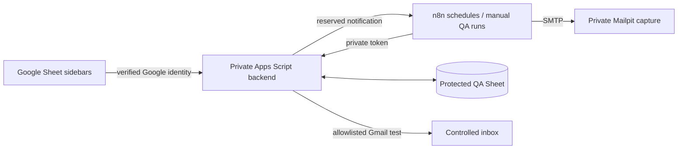

# Recurring Operations Automation

Google Sheets is the employee and manager operating interface. Employees use
**Ops Tasks → My tasks** to enter a ticket or daily report once. The state engine
records completion and history, prepares recurring work, evaluates SLA and
tracks manager acknowledgement independently of employee resolution.

## Current demonstration status

A separate private QA Sheet and owner-only Apps Script backend are deployed.
Live employee completion, daily reports, recurrence, Mailpit manager/leadership
notifications, calendar rules and retry prevention have genuine evidence.
**Six assignment cases PASS; two are BLOCKED:** receiving Gmail inbox verification
and authenticated second-account manager acknowledgement. The original dummy
prototype and its active dry-run schedules remain separate.

Start with the [actual acceptance report](tests/test-results.md),
[genuine screenshots and record evidence](docs/evidence.md), and
[5–10 minute presenter walkthrough](tests/demo-script.md).
Private resource links and controlled Google account addresses are provided separately.

| Deliverable | Review material |
| --- | --- |
| Working Google Sheet prototype | Private QA Sheet: four dummy tasks, protected queue/history/dashboard/log/configuration, Sheet sidebars |
| Apps Script / automation | [Engine](apps-script/TaskManager.gs), [QA backend](apps-script/QA.gs), [Sheet client](apps-script/QASheetClient.gs), [sanitized QA n8n workflows](n8n-workflows/qa/) |
| Daily Task Completion Tracking | [Method and genuine live result](docs/daily-completion.md) |
| Manager Alerts & Leadership Escalation | [Timing](docs/sla-logic.md), three transports, [actual captures](docs/evidence/qa/mailpit-captures.json) |
| Working Demonstration / Test Cases | [Eight-case results](tests/test-results.md), [walkthrough and reset](tests/demo-script.md), [requirement audit](docs/requirements-checklist.md) |



Daily work is generated independently each working day. Periodic next due dates
are completion date + 7 / 15 / 30 calendar days, rolled forward over weekends
and configured holidays. QA visibly uses simulated business time; execution
and mail timestamps remain real. See [architecture](docs/architecture.md).

## Setup and review

Follow [QA installation](docs/qa-setup.md), [deployment record](docs/deployment-record.md)
and [verified limits](docs/limitations.md). Original prototype setup remains in
[setup](docs/setup.md). Do not reset an existing original workbook.

The existing local regression suite still passes **19/19**:

```bash
node --test tests/automated/engine.test.cjs tests/automated/apps-script.test.cjs tests/automated/sidebar.test.cjs
```

These tests do not replace integrated acceptance evidence. SMTP capture and
MailApp API acceptance do not independently establish Gmail inbox arrival.
No assignment material has been submitted and no employer mailbox contacted.

License: MIT.
