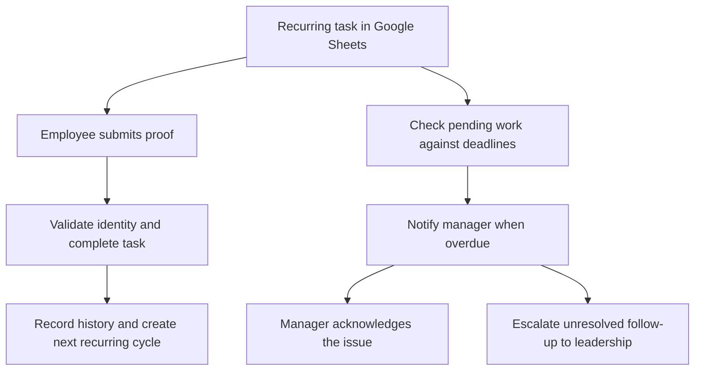
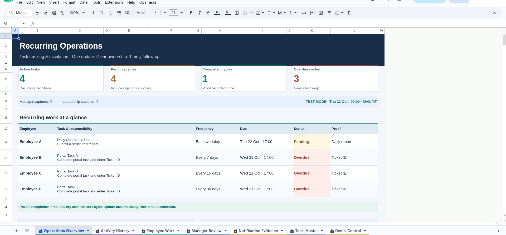

# Recurring Task Tracking & Escalation Automation

**AI Operations Manager Assignment — Allo Innoware**

- **[Open Working Google Sheet](https://docs.google.com/spreadsheets/d/1GGHWD76huphPMWxuvm51wcVzk9tYnTwoC4g8oo_Yecc/edit)**
- **[Watch 8:31 End-to-End Demonstration](docs/demo/assignment-walkthrough.mp4)**
- **[View Eight Acceptance Test Results](tests/test-results.md)**
- **[Explore Source Code and Setup](#source-code-and-setup)**

Employees record recurring work once in Google Sheets. The system saves completion
proof and history, creates the next cycle, alerts managers about missed deadlines,
and escalates unresolved work to leadership.

**Verified: 8/8 integrated QA acceptance cases passed · 22/22 local regression tests passed.**

## The business problem

Recurring work is easy to miss when assignments, completion evidence and reminders
live in separate trackers. Managers need one place to see what is due, what is
overdue, and whether an issue has been reviewed or actually resolved.

## The solution

Google Sheets is the everyday operating interface. Employees submit proof through
a sidebar; managers review overdue work in one dashboard. The automation maintains
the records without requiring a second spreadsheet update.

Acknowledging an issue records the manager's review. The employee's task remains
Pending until completion proof is submitted separately.

## Inspect the product, then inspect the proof

| Environment | What to inspect | Verified scope |
| --- | --- | --- |
| **Public Presentation Sheet** | Operations Overview, Employee Work, Manager Review, Activity History and Notification Evidence | Genuine authenticated daily completion; one history event; next daily cycle and duplicate prevention |
| **Private QA Sheet** | Sanitized video, acceptance report and linked evidence | All eight integrated scenarios, authenticated manager acknowledgement, actual n8n runs, Mailpit manager/leadership messages and limited verified Gmail delivery |

The presentation Sheet is publicly accessible as **Viewer**: reviewers can inspect
the workbook, but cannot submit tasks through its authenticated sidebars. Its
alert schedules are intentionally inactive. No presentation notification or
manager-acknowledgement pass is claimed; those tests were performed in private QA.
Its empty Notification Evidence view means no alerts were triggered there.

The **8:31 video shows both environments**: the polished product first, then
genuine QA proof. Historical actions are labelled, and QA records are not copied
into presentation history. The video is 1080p with timed captions and no audio.
Private QA's actual Sheet URL and configuration are never published.

[Transcript and chapter timings](docs/demo/assignment-walkthrough.md) ·
[Recording provenance](docs/demo/assignment-walkthrough-provenance.json) ·
[Supplementary 5:10 technical review](docs/demo/qa-screen-review.mp4)

## How employees and managers use it

| Step | What happens |
| --- | --- |
| **Find assigned work** | Employees open **Ops Tasks → My tasks** to see their tasks, due dates and required proof. |
| **Complete once** | Submit a Ticket ID, or a daily report covering completed work, pending work/count and blockers. |
| **Track the result** | The backend verifies the signed-in user, marks the cycle Completed, and records proof, identity and timestamp in history. |
| **Continue recurring work** | Periodic completion creates a linked next cycle. Daily work is generated independently each working day. |
| **Review an overdue issue** | Managers receive an alert and use **Ops Tasks → Manager review → Acknowledge**. Review and employee resolution remain separate. |
| **Escalate unresolved work** | At the leadership threshold, unresolved follow-up produces an escalation with the employee, task, cycle and reason. |

The sidebars are the authorized update path; system-maintained cells are protected.
[Presentation checks](docs/evidence/presentation/verification.json) document its
actual completion, recurrence, replay and authorization results.

## Four demonstration assignments

| Employee | Task | Frequency | Completion proof |
| --- | --- | --- | --- |
| A / EMP-A | Daily Operations Update | Each working day | Completed work, pending work/count and blockers |
| B / EMP-B | Portal Task A | Every 7 days | Ticket ID |
| C / EMP-C | Portal Task B | Every 15 days | Ticket ID |
| D / EMP-D | Portal Task C | Every 30 days | Ticket ID |

Employee A uses the owner's authenticated Google account; the test manager uses
a separate authenticated account. B/C/D remain distinct dummy employees. Their
QA completions were administrator simulations through the real engine, explicitly
labelled **SIMULATED**, not separate authenticated employee logins. Earlier
authenticated Ticket ID testing temporarily assigned a portal task to the owner;
the video identifies that historical run separately.

## SLA policy and duplicate prevention

These times are **proposed demonstration policy**, not employer-supplied
requirements. All business times use India time.

| Milestone | Policy |
| --- | --- |
| Task deadline | 17:00 on its due day |
| Manager alert | Same day at 17:15 |
| Manager acknowledgement target | Next working day at 10:00 |
| Leadership escalation threshold | Next working day at 14:00 |

Daily cycles skip weekends and configured holidays. Periodic recurrence is
completion date + 7/15/30 calendar days, rolled forward to a working day. Stable
cycle/alert IDs, locks and notification claims prevent ordinary retries from
creating duplicate records or sends. [Timing rules and exceptions](docs/sla-logic.md).

## How the tools work together

| Tool | Responsibility |
| --- | --- |
| **Google Sheets** | Employee and manager interface, task records and review views |
| **Google Apps Script** | Identity checks, completion validation, history, recurrence and SLA decisions |
| **n8n** | Scheduled checks and notification orchestration using the shared business rules |
| **Mailpit** | Safe capture of actual test SMTP messages for repeated manager/leadership testing |
| **Gmail** | Limited external delivery verification: two messages observed in the recipient's Inbox |

The main Gmail account is the automation sender, project owner and Employee A.
The separate test-manager Gmail is the manager identity and approved recipient.
Their addresses stay in private configuration. **Mailpit capture proves SMTP test
receipt; Gmail Inbox observation proves external delivery. They are separate evidence.**

## Acceptance results

**8/8 integrated QA cases passed. 22/22 local regression tests passed.**
Local checks support the implementation; they do not substitute for integrated
evidence. The presentation deployment has its own narrower checks above.

| Assignment case | QA result | Genuine evidence |
| --- | --- | --- |
| 1. Recurring task generation | PASS | [Completion and correct next cycle](docs/evidence/qa/ticket-completed.json), [distinct-role final records](docs/evidence/qa/role-final-state.json) |
| 2. Single-point Ticket ID completion | PASS | [Employee sidebar result](docs/screenshots/qa/next-seven-day-cycle.png), [repeat submission](docs/evidence/qa/replay-portal.json) |
| 3. Daily report without Ticket ID | PASS | [Authenticated Employee A report](docs/evidence/qa/role-employee-a-confirmed.json) |
| 4. Same-day manager notification | PASS | [Actual workflow runs](docs/evidence/qa/role-workflow-results.json), [Mailpit captures](docs/evidence/qa/role-mailpit-captures.json), [Gmail Inbox verification](docs/evidence/qa/gmail-inbox-verification.json) |
| 5. Manager acknowledgement | PASS | [Separate authenticated manager; task remains Pending](docs/evidence/qa/role-manager-ack-confirmed.json) |
| 6. Leadership escalation | PASS | [Unresolved D escalated; resolved C excluded](docs/evidence/qa/role-leadership-alerted.json) |
| 7. SLA and calendar timing | PASS | [Threshold checks](docs/evidence/qa/role-workflow-results.json), [weekend/holiday workflow results](docs/evidence/qa/workflow-results.json) |
| 8. Duplicate prevention | PASS | [Repeated workflows](docs/evidence/qa/role-workflow-results.json), [overlapping simulation calls](docs/evidence/qa/overlapping-dummy-completion.json) |

[Full acceptance report: steps, counts and scope](tests/test-results.md) ·
[Supporting evidence index](docs/evidence.md)

## How a Company Would Deploy This

1. Create its own Google Sheet and Apps Script deployment.
2. Configure real employee and manager identities and permissions.
3. Import the provided n8n workflows and connect company-owned credentials.
4. Set task frequencies, working days, SLA rules and notification recipients.
5. Use company-owned email credentials for live delivery; retain dry-run mode for safe checks.
6. Provide role-separated employee access and verify task ownership on every update.

This shared presentation workbook is an **administrative/reviewer demonstration**,
not a production-secure employee portal. Hidden tabs and protected ranges do not
isolate read access between workbook editors.

### Source code and setup

[Apps Script source](apps-script/) · [n8n workflow exports](n8n-workflows/) ·
[QA setup](docs/qa-setup.md) · [Presentation setup and access](docs/presentation-environment.md) ·
[Original setup](docs/setup.md) · [Deployment record](docs/deployment-record.md) ·
[Architecture](docs/architecture.md)

The shared client contains no automation token. A separate private backend checks
Google-signed identity tokens and task ownership, keeps SLA decisions central,
and reserves notifications before n8n sends them and records the outcome.
Presentation is isolated from QA and rejects external Gmail sending. Private
OAuth authorizations, credentials and deployment endpoints are not included.

## Limitations and privacy

- Business time is simulated in the demonstrations; authentication, execution timestamps and captured messages are real. No multi-day real-time scheduler waiting is claimed.
- B/C/D simulations are labelled; two distinct authenticated employees submitting simultaneously remain unverified.
- SMTP acceptance and recording its receipt are separate operations. A crash between them is not exactly-once guaranteed; uncertain outcomes require reconciliation.
- An already-sending notification cannot be retracted after acknowledgement or completion.
- Ticket IDs and daily reports are employee attestations; external portal work is not independently validated.
- Presentation notification and manager-acknowledgement testing was not repeated; its proof is retained in private QA.
- Public media is sanitized. Private QA remains restricted. Google may reveal the presentation file owner's identity through its own metadata.

[Full verified limitations](docs/limitations.md) · [Privacy review](docs/privacy-review.md) ·
[Presenter walkthrough and reset precautions](tests/demo-script.md)

## Repository structure

| Location | Contents |
| --- | --- |
| [apps-script/](apps-script/) | Shared engine, isolated backends and Sheet clients |
| [n8n-workflows/](n8n-workflows/) | Sanitized workflow exports |
| [docs/](docs/) | Architecture, setup, SLA, deployment and privacy |
| [tests/](tests/) | Acceptance report, local regressions and presenter script |
| [docs/demo/](docs/demo/) | Primary video, captions and supplementary review |
| [docs/evidence/](docs/evidence/) | Sanitized actual records and recording provenance |

Nothing has been submitted to Allo Innoware and no employer mailbox has been
contacted. The owner decides whether to submit the assignment.

License: MIT.
