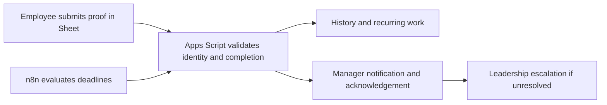

# Recurring Task Tracking & Escalation Automation

**AI Operations Manager Assignment — Allo Innoware**

Employees record recurring work once in Google Sheets. Completion evidence,
history and the next cycle update automatically; missed deadlines go to a
manager, then to leadership when follow-up remains unresolved.

**[Watch the 8:31 primary walkthrough](docs/demo/assignment-walkthrough.mp4)** ·
[Working Sheet access](docs/presentation-environment.md#access-and-deployment) ·
[Eight-case acceptance report](tests/test-results.md) ·
[Source and setup](docs/qa-setup.md)

| Environment | Purpose | Verified scope |
| --- | --- | --- |
| **Presentation Sheet** | What the system looks like and how people use it | Independent backend; genuine authenticated daily completion, history, next daily cycle and replay prevention |
| **Private QA** | Where end-to-end acceptance tests were proven | Eight integrated cases, separate authenticated manager, Mailpit captures and two verified Gmail Inbox messages |

The walkthrough shows the polished product first, then genuine retained QA
evidence. QA links and private configuration are not published. Presentation
viewer access is controlled by the owner; unrestricted sharing is not enabled.

The video is 1080p with timed captions and no audio.
[Transcript and chapter timings](docs/demo/assignment-walkthrough.md) ·
[Recording provenance](docs/demo/assignment-walkthrough-provenance.json).


## The problem

Manual reminders and multiple trackers make recurring work hard to follow.
Managers need to know what was completed, what is overdue and who has reviewed
an issue without chasing each employee separately.

## The solution

Employees open **Ops Tasks → My tasks**, submit a Ticket ID or structured daily
report, and receive a recorded completion. Managers use **Manager review** to
acknowledge issues and inspect later resolution. Acknowledgement does not complete
the employee's task. Notifications and leadership escalation follow one shared
set of business rules.

## How it works



## What you'll see

| Presentation view | Use |
| --- | --- |
| Operations Overview | Four assignments, frequencies, due dates and live counts |
| Employee Work + completion sidebar | One place to enter proof and inspect recurring cycles |
| Manager Review | Consolidated work status, acknowledgement and independent resolution |
| Activity History | Real events, business time, actual execution time and action source |
| Notification Evidence | Alerts recorded in this workbook; currently empty because its alert workflows have not been run |

[Presentation history](docs/screenshots/presentation/activity-history.png) ·
[Manager view](docs/screenshots/presentation/manager-review.png) ·
[Duplicate prevention](docs/screenshots/presentation/completion-replay.png)

An empty presentation notification log is expected. Verified notification
captures are retained in the separate private QA environment, not copied into
the presentation workbook.

## Demo in 60 seconds

1. Start the [primary walkthrough](docs/demo/assignment-walkthrough.mp4): product first, acceptance proof second.
2. Inspect the [eight-case report](tests/test-results.md) and its linked real records.
3. Use the [presentation access guide](docs/presentation-environment.md) for controlled workbook review.

The earlier [5:10 technical screen review](docs/demo/qa-screen-review.mp4) remains
supplementary material. Recorded outcomes are explicitly distinguished from newly
performed actions; the main walkthrough is not an uninterrupted recording of
eight first-time tests.

## Four recurring task scenarios

| Employee | Assignment | Frequency | Completion proof |
| --- | --- | --- | --- |
| A / EMP-A | Daily Operations Update | Each working day | Completed work, pending work/count and blockers |
| B / EMP-B | Portal Task A | 7 days | Ticket ID |
| C / EMP-C | Portal Task B | 15 days | Ticket ID |
| D / EMP-D | Portal Task C | 30 days | Ticket ID |

Employee A uses the owner's authenticated Google account. B/C/D have distinct
dummy identities; their QA completions are administrator-only simulations,
explicitly recorded as `SIMULATED`. Earlier authenticated portal testing temporarily
assigned a portal task to the owner and is retained as a separate historical run.

## Automation and SLA

The **proposed demonstration policy** uses India time: task deadline 17:00,
same-day manager alert 17:15, manager acknowledgement target next working day
10:00, leadership threshold next working day 14:00. These times were chosen for
the prototype, not supplied by the employer.

Daily cycles are generated independently on working days. Periodic recurrence is
completion date + 7/15/30 calendar days, rolled forward over weekends and configured
holidays. Deterministic IDs, locks and notification claims prevent ordinary retry
duplicates. [Exact rules and exceptions](docs/sla-logic.md).

## Technology

- **Google Sheets:** employee/manager interface and protected records.
- **Apps Script:** verified identity, validation, state transitions, recurrence and SLA.
- **n8n:** controlled workflow execution and notification orchestration.
- **Mailpit:** actual SMTP test captures inside private infrastructure.
- **Gmail:** two limited external test messages independently verified in the recipient's Inbox.

The main Gmail account is the automation sender, project owner and authenticated
Employee A. A separate testing Gmail account is the authenticated manager and
limited Gmail-test recipient. Actual addresses are kept in private configuration.
Repeated notification testing uses Mailpit's `.test` recipients.

## Testing and results

**Eight integrated acceptance cases PASS. Local regression: 22/22 PASS.**
These are distinct kinds of evidence. The new presentation deployment has its
own narrower [executed checks](docs/evidence/presentation/verification.json).

| Case | Integrated QA result | Evidence |
| --- | --- | --- |
| 1. Recurring cycle | PASS | [Authenticated ticket and next cycle](docs/evidence/qa/ticket-completed.json) |
| 2. Single-point completion | PASS | [Sidebar result and repeat](docs/evidence/qa/replay-portal.json) |
| 3. Daily report without Ticket ID | PASS | [Authenticated daily report](docs/evidence/qa/role-employee-a-confirmed.json) |
| 4. Same-day manager alert | PASS | [Mailpit captures](docs/evidence/qa/role-mailpit-captures.json), [Gmail Inbox](docs/evidence/qa/gmail-inbox-verification.json) |
| 5. Manager acknowledgement | PASS | [Separate signed-in manager; employee still Pending](docs/evidence/qa/role-manager-ack-confirmed.json) |
| 6. Leadership escalation | PASS | [Unresolved D escalated; resolved C excluded](docs/evidence/qa/role-leadership-alerted.json) |
| 7. SLA timing | PASS | [Actual threshold workflow results](docs/evidence/qa/role-workflow-results.json), [holiday scenario](docs/evidence/qa/workflow-results.json) |
| 8. No duplicates | PASS | [Repeated workflows](docs/evidence/qa/role-workflow-results.json), [overlapping calls](docs/evidence/qa/overlapping-dummy-completion.json) |

See [steps, preconditions, counts and limitations](tests/test-results.md) and
[sanitized supporting evidence](docs/evidence.md). Current QA records remain
8 cycles / 5 Completed / 6 history events / 3 alerts. Real capture and execution
times remain distinct from the simulated business clock.

## Architecture

The shared Sheet client holds no automation token and cannot directly mutate
protected state. A separate owner-only backend validates Google-signed identity
tokens and task ownership. n8n uses a private automation token. Apps Script
reserves notifications centrally; n8n claims each message, sends through Mailpit
SMTP and reports transport outcomes. Gmail-test delivery is restricted to an
approved private recipient. [Architecture](docs/architecture.md).

The presentation backend is independently pinned to its own workbook and rejects
the original and private QA IDs. Its Sheet records use role aliases; verified
account identities remain in private backend configuration/audit properties.
External Gmail sending is disabled in this presentation deployment.

## Deploy or reproduce

Follow [QA setup](docs/qa-setup.md), [presentation setup](docs/presentation-environment.md),
[deployment record](docs/deployment-record.md) and [original setup](docs/setup.md).
Source and sanitized workflow exports are provided; private OAuth authorizations,
tokens, deployments and credentials are not included.

Companies must use their own Google accounts, automation credentials and
notification recipients, with access-separated employee interfaces. This shared
presentation workbook is an **administrative/reviewer demo**, not a production-secure
employee-by-employee portal. Hidden tabs and protected ranges do not isolate
read access between workbook editors.

```bash
node --test tests/automated/*.test.cjs
```

## Important limitations

- Business time is simulated in QA/presentation; authentication, executions and recorded message captures are real.
- Dummy B/C/D simulations are not authenticated Google logins.
- Mailpit capture is not Gmail Inbox delivery; API acceptance alone is not receipt evidence.
- SMTP acceptance followed by a crash before receipt is not exactly-once guaranteed; uncertain delivery is recorded honestly.
- Two distinct authenticated employees submitting concurrently remain unverified.
- Presentation manager acknowledgement and notification delivery were not newly repeated; their proof comes from private QA.

[Full verified limits](docs/limitations.md) · [Presenter walkthrough/reset precautions](tests/demo-script.md)

## Repository guide

| Location | Contents |
| --- | --- |
| [apps-script/](apps-script/) | Shared engine, isolated backend and Sheet clients |
| [n8n-workflows/](n8n-workflows/) | Sanitized importable workflows |
| [docs/](docs/) | Architecture, SLA, setup, deployment and privacy |
| [tests/](tests/) | Local checks and genuine integrated acceptance report |
| [docs/demo/](docs/demo/) | Primary walkthrough and supplementary technical video |
| [docs/evidence/](docs/evidence/) | Sanitized actual records and recording provenance |

## Privacy and access

Public screenshots/video omit private identities, URLs, credentials and unrelated
personal material. Private QA stays private. Google may still reveal a workbook
owner's identity through its own file metadata; role aliases do not hide that.
Viewer review and trusted authenticated testing require different access.
[Privacy review](docs/privacy-review.md) · [Access plan](docs/presentation-environment.md#access-and-deployment)

Nothing has been submitted to the employer and no employer mailbox has been
contacted. The owner decides whether to submit this assignment.

License: MIT.
