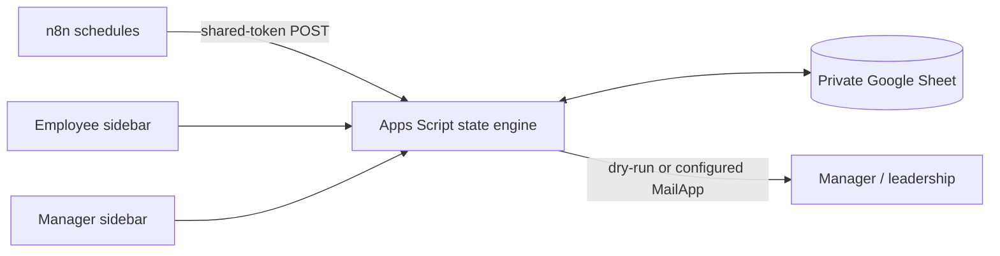

# Recurring Operations Automation

A Google Sheets operations tracker for four example recurring tasks. Employees open **Employee_Queue** and use the **My tasks** sidebar to submit a ticket or daily report once. Managers see every open issue in **Manager_Dashboard**, acknowledge alerts separately, and receive escalation emails after the configured SLA. n8n supplies schedules; Apps Script owns state changes.

**Private prototype Sheet:** a native workbook with dummy identities has been prepared. Its private link is supplied separately in the review package. The Apps Script has not yet been attached or authorized. The imported n8n workflows are inactive until deployment is completed.

## What is included

| Assignment deliverable | Prototype material |
| --- | --- |
| Working Google Sheet prototype | Private six-tab native Sheet with task master, employee queue, history, manager dashboard, alert log and settings |
| Apps Script / automation | [State engine](apps-script/TaskManager.gs), [Sheet adapter](apps-script/Code.gs), employee and manager sidebars |
| Daily Task Completion Tracking | Required structured report: work completed, pending work and count, blockers, optional remarks |
| Manager Alerts & Leadership Escalation | Configurable weekday schedules, independent acknowledgement, reserved deduplication keys, dry-run default |
| Working Demonstration / Test Cases | [14 executed local tests](tests/test-results.md), covering all eight assignment scenarios and edge cases |

## Flow



The daily task is generated for each working day regardless of an older unresolved daily task. A periodic task's next due date is its completion date plus 7, 15 or 30 calendar days, rolled forward over weekends and configured holidays. Completion creates the next linked cycle immediately. The dashboard records resolution and acknowledgement independently.

## Run the demonstration locally

Requires Node.js 22 or newer. No credentials are needed.

```bash
node --test tests/automated/engine.test.cjs
node --test tests/automated/apps-script.test.cjs
```

The tests use an injected clock and do not send email. See [test results](tests/test-results.md) and the [eight-case demonstration script](tests/demo-script.md).

## Deploy

Follow [setup](docs/setup.md) for Apps Script attachment, authenticated employee identity, n8n environment variables, safe recipient configuration and activation. Review [architecture](docs/architecture.md), [SLA rules](docs/sla-logic.md), and [limitations](docs/limitations.md) first. Three importable n8n workflow JSON files are in [n8n-workflows](n8n-workflows/). Completion runs inside Apps Script, so there is no duplicate n8n completion workflow.

**Current status:** the Sheet exists and the local engine tests pass; the bound Apps Script and live notification path have not been deployed or tested. Do not enter a real manager address or activate the schedules until a controlled dry-run and identity check succeed.

## Safety

Dummy emails use the non-deliverable `.invalid` domain. `dryRun=true` is the default. The private Sheet is not publicly editable. This repository contains no assignment document, real employee data, credentials, or live webhook URLs. No assignment material has been sent to the employer.

License: MIT.
