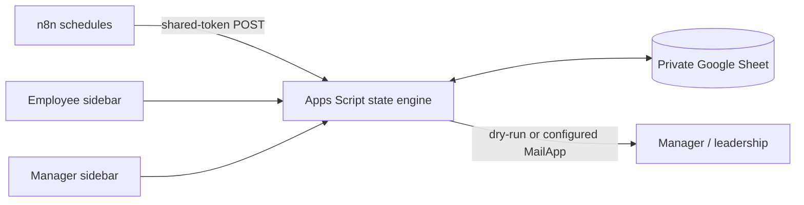

# Recurring Operations Automation

A Google Sheets operations tracker for four example recurring tasks. Employees open **Employee_Queue** and use **Ops Tasks → My tasks** inside the Sheet to submit a ticket or daily report once. Managers see every open issue in **Manager_Dashboard**, acknowledge alerts separately, and receive escalation emails after the configured SLA. n8n supplies schedules; Apps Script owns state changes.

**Private prototype Sheet:** a native workbook with dummy identities has been prepared. Its private link is supplied separately in the review package. The bound Apps Script web app runs version 4 and three n8n schedules are active in dry-run mode. This is a dummy prototype with incomplete live acceptance evidence; see the [requirement audit](docs/requirements-checklist.md).

## What is included

| Assignment deliverable | Prototype material |
| --- | --- |
| Working Google Sheet prototype | Private six-tab native Sheet with task master, employee queue, history, manager dashboard, alert log and settings |
| Apps Script / automation | [State engine](apps-script/TaskManager.gs), [Sheet adapter](apps-script/Code.gs), employee and manager sidebars |
| Daily Task Completion Tracking | [Daily completion method](docs/daily-completion.md): authenticated report of completed work, pending work/count and blockers |
| Manager Alerts & Leadership Escalation | Configurable weekday schedules, independent acknowledgement, reserved deduplication keys, dry-run default |
| Working Demonstration / Test Cases | [19 executed local tests](tests/test-results.md), covering all eight assignment scenarios and edge cases |

## Flow



The daily task is generated for each working day regardless of an older unresolved daily task. A periodic task's next due date is its completion date plus 7, 15 or 30 calendar days, rolled forward over weekends and configured holidays. Completion creates the next linked cycle immediately. The dashboard records resolution and acknowledgement independently.

## Run the demonstration locally

Requires Node.js 22 or newer. No credentials are needed.

```bash
node --test tests/automated/engine.test.cjs
node --test tests/automated/apps-script.test.cjs
node --test tests/automated/sidebar.test.cjs
```

The tests use an injected clock and do not send email. See [test results](tests/test-results.md) and the [eight-case demonstration script](tests/demo-script.md).

## Deploy

Follow [setup](docs/setup.md) for Apps Script attachment, authenticated employee identity, n8n environment variables, safe recipient configuration and activation. Review [architecture](docs/architecture.md), [SLA rules](docs/sla-logic.md), and [limitations](docs/limitations.md) first. Three importable n8n workflow JSON files are in [n8n-workflows](n8n-workflows/). Completion runs inside Apps Script, so there is no duplicate n8n completion workflow.

**Current status:** the private Sheet is the human operating interface: its custom menu opens an employee sidebar and a manager review sidebar, both backed by the same Apps Script state service used by the bound web app and n8n. The web app is the automation endpoint. The Sheet, web app, and three active n8n schedules are connected. Earlier live n8n calls returned recurrence `created:0`, manager `alerts:0`, and leadership `alerts:0` before the deadline. After deploying version 4, direct web app calls returned the same counts, repeated recurrence created zero cycles, and the three n8n schedules were confirmed active. The live dashboard now shows acknowledgement deadlines; see the [deployment record](docs/deployment-record.md). The Sheet still uses dummy `.invalid` identities and `dryRun=true`; authenticated employee and manager submissions, real email delivery and live concurrency remain unverified.

## Safety

Dummy emails use the non-deliverable `.invalid` domain. `dryRun=true` is the default. The private Sheet is not publicly editable. [Genuine interface screenshots](docs/screenshots/) show the employee queue and successful Apps Script execution. This repository contains no assignment document, real employee data, credentials, or live webhook URLs. No assignment material has been sent to the employer.

License: MIT.
