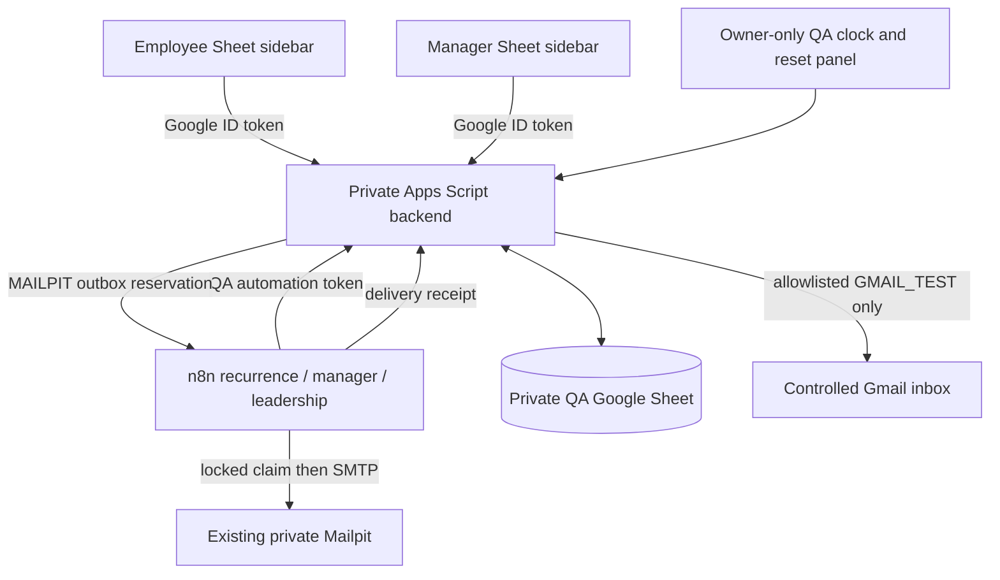

# Architecture and design decisions

Google Sheets remains the primary employee and manager interface. The shared
bound project contains only the sidebar client and a nonsecret backend URL.
The existing engine and selected Sheet adapter functions run in an owner-only
standalone project. This separation prevents Sheet editors from acquiring the
backend's automation secret, clock controls or recipient configuration.

Consumer Google accounts are authenticated using `ScriptApp.getIdentityToken()`
in the bound client. The backend validates the Google token through tokeninfo,
its audience, issuer, verified email and expiry against real time. Client-supplied
actor names are never trusted. Blank identity is rejected. Manager identity is
configured separately from notification recipients. The original deployment
continues separately with dummy identities and dry-run schedules.

## State and concurrency

The private backend uses a script lock to serialize state changes. Cycle IDs
combine task ID and due date. Completion records proof, authenticated actor,
business timestamp, actual execution timestamp and one history event, then
creates the linked periodic cycle. Repeated completion returns `duplicate:true`.
Daily recurrence generates one cycle per working day independently of older
unresolved daily work.

Notification keys contain transport, level and cycle ID. A dry-run record cannot
suppress a later Mailpit or Gmail test. Apps Script alone evaluates SLA rules;
n8n schedules and transports messages without reimplementing those rules.
Mailpit uses `QUEUED → SENDING → SENT` with a locked claim before SMTP. Uncertain
outcomes remain `UNKNOWN` or `SENDING` for reconciliation rather than blind retry.
SMTP and Sheets cannot commit atomically; this is retry deduplication, not a
promise of exactly-once delivery after every possible crash.

## QA tabs

| Tab | Purpose | Writer |
| --- | --- | --- |
| Task_Master | Four definitions, identities and recurrence | Administrator |
| Demo_Control | Visible TEST MODE, clock, interface instructions | Backend |
| Employee_Queue | Cycle state, proof, completion and next cycle | Backend |
| Task_History | Completion and acknowledgement audit events | Backend |
| Manager_Dashboard | Consolidated pending/overdue, review and resolution | Backend |
| Alert_Log | Reservations, delivery state and actual timestamps | Backend |
| Settings | Holidays, SLA and QA configuration | Administrator |

All seven QA tabs have whole-sheet owner-only protections. Employees and the
manager use sidebars to update state; the owner can still edit protected cells.
The administrator panel is a separate owner-only web deployment. The automation
endpoint allows public access at Google's deployment layer, but every POST is
validated using either the private automation token or a role-scoped Google token.

See [QA setup](qa-setup.md), [SLA](sla-logic.md), [acceptance results](../tests/test-results.md)
and [limitations](limitations.md). Local tests exercise the shared engine and
original adapter; they do not substitute for live identity or delivery evidence.
