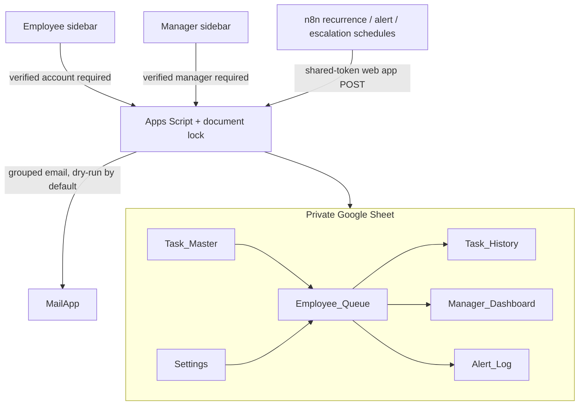

# Architecture and design decisions

The Apps Script document lock serializes state transitions. Cycle IDs combine task ID and due date. Every completion is recorded once in the queue and history; a repeated submission returns `duplicate: true`. Alert keys combine level and cycle ID. The alert is reserved in `Alert_Log` before email delivery. A delivery failure is marked `UNKNOWN` and requires manual reconciliation; it is not blindly resent. MailApp does not expose a provider message ID, so that column stays blank.

The Google Sheet is the primary human operating interface. Employees open **Employee_Queue → Ops Tasks → My tasks** and submit proof in its bound sidebar; managers open **Manager_Dashboard → Ops Tasks → Manager review** and acknowledge alerts there. Both sidebars call the same `submitCompletion` and `managerAcknowledge` services used by the state engine. The Apps Script web app is an optional server endpoint for n8n scheduling and does not replace the Sheet interface. Programmatic web app writes call `writeState` directly; the design does not depend on `onEdit` triggers.

The full Sheet is the system of record. n8n only schedules three calls to the same state manager. The employee and manager sidebars run with Google account identity; they reject an empty identity or an actor outside the assigned role. A bound script must run in a Google Workspace configuration that exposes authenticated email to `Session.getActiveUser()`. The current Sheet uses dummy `.invalid` users, so live identity testing requires controlled accounts.

The local tests load the same pure `TaskManager.gs` engine that Apps Script uses. They do not simulate Sheet API permissions, MailApp delivery, or n8n execution.

## Tab ownership

| Tab | Purpose | Typical editor |
| --- | --- | --- |
| Task_Master | Definitions and recurrence | Administrator |
| Employee_Queue | Single employee operating view and cycle state | Sidebar / state engine |
| Task_History | Audit trail | State engine |
| Manager_Dashboard | Open and alerted issues, overdue age, escalation and resolution | State engine |
| Alert_Log | Delivery reservation and status | State engine |
| Settings | Time zone, holiday list, SLA and recipients | Administrator |

Task_Master and Settings are protected in the native Sheet. The queue itself is editable by Sheet editors, so raw direct edits can bypass sidebar validation. Restrict access to trusted participants or move the state tabs to a separate owner-only workbook before production use.
